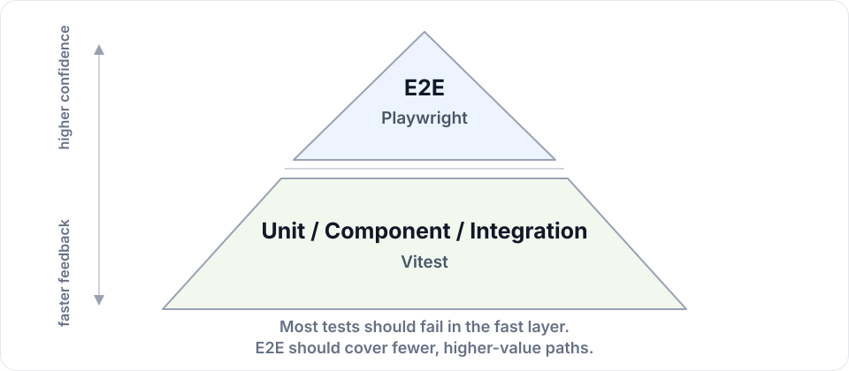

# vitest-plugin-rsc

> Test React Server Components and Next.js App Router apps in Vitest Browser Mode.

[](https://www.npmjs.com/package/vitest-plugin-rsc)
[](https://github.com/storybookjs/vitest-plugin-rsc/actions/workflows/ci.yml)
[](LICENSE)
[](https://nodejs.org/)
[](https://pnpm.io/)

`vitest-plugin-rsc` runs your server code in the browser tab of your test. For a Next.js app, that means the whole app. Next's own request handler renders a route, the browser shows the HTML, Next's own client code hydrates it, and a Server Action runs on Next's own server code.

A test then covers a slice that unit tests and E2E tests can't easily reach:

**DB → RSC → pixels → actions → DB → pixels. One slice at a time.**

Pick one piece of the app, such as a notes form, a settings panel or a whole route. Seed exactly the state it needs and render it. Then use the hydrated UI in a real browser, run its Server Actions, and assert on what the user sees and what the server stored.

```tsx
test("archive a note", async () => {
  // seed DB
  await signedInAs(testUser);
  await db.insert(notes).values({ ownerId: testUser.id, title: "Inbox triage" });

  // RSC -> pixels
  await renderServer({ url: "/notes" });
  await expect.element(page.getByText("Inbox triage")).toBeVisible();

  // action -> DB -> pixels
  await page.getByRole("button", { name: "Archive Inbox triage" }).click();
  await expect.element(page.getByText("Inbox triage")).not.toBeInTheDocument();
});
```

The `db` the test seeds is the same module instance that the Server Component reads. In the notes demo, the database behind it is Postgres, compiled to WebAssembly, running in the tab.

## Table Of Contents

- [Why This Exists](#why-this-exists)
- [What You Get](#what-you-get)
- [Node.js In The Browser](#nodejs-in-the-browser)
- [Databases](#databases)
- [Requirements](#requirements)
- [Next.js](#nextjs)
  - [Set Up](#set-up)
  - [Render A Component](#render-a-component)
  - [A Test File With `"use client"`](#a-test-file-with-use-client)
  - [Example: Server Action Form](#example-server-action-form)
  - [Router Hooks And Links](#router-hooks-and-links)
  - [Request Headers And Cookies](#request-headers-and-cookies)
  - [Cache And Revalidation](#cache-and-revalidation)
  - [Open A Whole Route](#open-a-whole-route)
  - [Route Handlers](#route-handlers)
  - [Code That A Server Action Calls](#code-that-a-server-action-calls)
  - [The Proxy, Redirects And Rewrites](#the-proxy-redirects-and-rewrites)
  - [Mocks](#mocks)
  - [Fonts, Images And Styles](#fonts-images-and-styles)
  - [Server Code In The Browser](#server-code-in-the-browser)
  - [Environment Variables](#environment-variables)
  - [A Static Build](#a-static-build)
  - [API](#api)
- [React Server Components Without Next.js](#react-server-components-without-nextjs)
- [Test Concurrency](#test-concurrency)
- [How It Works](#how-it-works)
- [Playgrounds](#playgrounds)

## Why This Exists

Covering every state with E2E tests alone isn't practical:

- They are slow, because each test has to drive the UI into the state it checks.
- They are hard to run in parallel, because they share a server and a database.
- They are flaky, because they aren't isolated from each other.

So validation errors, roles, locales, feature flags, empty and error states, and anything that depends on the time mostly go untested. That coverage belongs at the base of the test pyramid.

<p align="center">
  
</p>

For Server Components, that base has been missing. Rendering them in a unit-style test has been [an open problem since 2023](https://github.com/testing-library/react-testing-library/issues/1209). So the whole RSC pipeline was left to E2E tests, which is exactly where broad coverage doesn't fit.

`vitest-plugin-rsc` fills that base. A component, a form or a whole route runs through the full pipeline: server render, Flight, HTML, hydration, Server Action and rerender. The test sets up its inputs directly, like rows, cookies, headers and the clock, and asserts on the rendered DOM with Playwright's locators and `expect.element`. The test mocks nothing of Next.js.

What the server talks to can live in the tab too. The disk is always in memory. With a recipe from [Databases](#databases), so is the database: a real engine in WebAssembly. A request to another server goes where the test sends it with [MSW](https://mswjs.io/docs/recipes/vitest-browser-mode). Nothing has to be deployed for a test, and that changes how tests behave.

Workers don't share anything. Vitest runs test files in parallel, each worker in a browser tab of its own, and each tab has its own server, database, disk, cookies and storage. So workers need no shared test database. Within one worker, test files run one after another, and with `isolate: false` they share the worker's modules, so they share its database too: the reset before each test is what keeps them apart. The tests in a test file run one after another as well, because `test.concurrent` doesn't work with Next's request context. See [Test Concurrency](#test-concurrency).

Every test starts from the same state. Before each test, the plugin empties the disk and the Data Cache, and opens a new browser context of your app: none of its cookies, and empty `localStorage` and `sessionStorage`. A test file with `"use client"` has the browser's own instead, as with Testing Library. A recipe's setup file puts the database back to what its migrations made, and fixes the clock with `vi.setSystemTime()`; on Postgres and MySQL, the database's `now()` follows that clock. What the plugin doesn't reset is the state of your own modules, like a `Map` in memory or a mock's implementation: reset that in a `beforeEach()`.

Storybook needs no server. With [`@storybook/nextjs-vite-rsc`](packages/storybook-nextjs-vite-rsc), a story renders a page of the app with the same mocks as the tests, and a static build of Storybook carries the database in the tab. In a deployed Storybook, a form submits and its Server Action writes to that database. Every story starts from an empty one. The notes demo, `playground/nextjs-notes-demo`, is built that way.

A fast, deterministic test file is also what an agent needs: edit, run the tests, repair, repeat. Server Components have been the hardest part of React to put in that loop.

## What You Get

- **Next.js as it runs**: routes, layouts, `loading.tsx`, error boundaries, redirects, cookies, Server Actions, route handlers, the Data Cache, `proxy.ts`, and the redirects, rewrites and headers in `next.config`.
- **Next's own compiler**: your files go through Next's SWC transform and its font and image loaders, so `next/font`, `next/image`, `next/dynamic` and styled-jsx work. A mistake that would break `next build` fails the test with Next's error.
- **A component, a form or a whole route**: test it without a deployment or a server, with `renderServer(<Node />)` or `renderServer({ url })`.
- **White-box inputs**: the `db` your test seeds is the module instance your Server Components read. Set the session, the cookies and headers, and the clock.
- **Black-box output**: assert what the user sees and does with `vitest/browser`: Playwright's locators, like `getByRole` and `getByText`, and the `expect.element` matchers.
- **Node.js on the server**: the modules of Node.js that a browser can provide, and an in-memory disk. See [Node.js In The Browser](#nodejs-in-the-browser).
- **Databases in the tab**: recipes for Postgres, SQLite and MySQL. See [Databases](#databases).
- **Per-test isolation**: each test starts with an empty Data Cache and disk. In a test file without `"use client"`, it also starts with none of your app's cookies and its own empty `localStorage` and `sessionStorage`.
- **Watch mode**: with `vitestPluginNext({ affectedTests: true })`, saving a file reruns the tests that use it. See [Watch Mode](docs/next-routes.md#watch-mode).

## Node.js In The Browser

With `vitestPluginNext()`, the server layers, `rsc` and `ssr`, have the modules of Node.js that a browser can provide. Server code is told it runs on a server, as Next's build tells it (see [Server Code In The Browser](#server-code-in-the-browser)), and it gets these modules in their place.

What Node.js and browsers share works as it is: `fetch`, `Request`, `Response`, `Headers`, `URL`, `FormData`, Web Streams, `TextEncoder`, `Blob`, `crypto.subtle`, `crypto.randomUUID()`, `structuredClone` and the timers.

Every module of Node.js that the server layers import is the plugin's own, `vitest-plugin-rsc/node/<name>`, one file each, from one place: no polyfill of Next's stands in for one. The plugin stands in for what Next's server needs:

| What                                 | Here                                                                                                                                                      |
| ------------------------------------ | --------------------------------------------------------------------------------------------------------------------------------------------------------- |
| `AsyncLocalStorage`                  | Runs one request at a time                                                                                                                                |
| `process`                            | One for the tab, shared by the test and the server: `env`, `cwd()` (`/`), `nextTick()`, `hrtime.bigint()`, and unenv's for the rest, like `platform`      |
| `buffer`, `events`, `util`, `assert` | The packages of Node's own code for a browser: buffer, events, util with Node's `inspect()`, and assert. `Buffer` also reads and writes `base64url`       |
| `node:stream`                        | readable-stream 4, the streams of Node.js 18 as a package, with `Readable.toWeb()` and `fromWeb()`                                                        |
| `node:path`                          | path-browserify, the POSIX path of Node.js                                                                                                                |
| `node:crypto`                        | Web Crypto for random values and `subtle`. SHA-256 in JavaScript for `createHash()` and `createHmac()`, and `timingSafeEqual()`. Another algorithm throws |
| `node:timers/promises`               | The page's timers, with `signal`                                                                                                                          |

`node:fs` and `node:fs/promises` are an in-memory disk, [memfs](https://github.com/streamich/memfs). The test's own `node:fs` is the same disk, so a test can write a file that the server reads, and read back what a Server Action wrote:

```ts
import fs from "node:fs";

test("shows the note on disk", async () => {
  fs.mkdirSync("/notes");
  fs.writeFileSync("/notes/today.txt", "Buy milk");

  await renderServer({ url: "/disk" });
  await expect.element(page.getByText("Buy milk")).toBeVisible();
});
```

- The disk starts empty for every test, with only `/tmp`, without any setup. What a setup file or a `beforeAll()` writes is gone before the test: write it in a `beforeEach()` or in the test.
- No file of your project is on it, and `process.cwd()` is `/`. A Server Component that reads `content/*.md` finds nothing until the test writes it.
- Only the server layers have it. A Client Component has no `fs`, as in Next.

See [The Server's Disk](docs/next-routes.md#the-servers-disk) for more.

The other modules are [unenv](https://github.com/unjs/unenv)'s stand-ins, made of what a browser has: `os`, `url`, `http`, `querystring` and the rest. What unenv has no stand-in for throws when it is called, not when it is imported, so a package that imports it still loads: `net.connect()`, `child_process.spawn()`, `http.request()`, `crypto.createSign()`. Some answer as a machine without them would: `os.hostname()` is `""`.

What doesn't run in a browser at all:

- Native addons, like `better-sqlite3`, `sharp` or `bcrypt`, don't load. Use a counterpart in JavaScript or WebAssembly, like `bcryptjs`, or mock the module that imports one.
- There are no TCP sockets, so a database driver can't reach its server. A recipe from [Databases](#databases) gives your app's ORM a database in the tab instead. A client that sends its requests with `fetch` works with MSW in front of it.

When you have a choice, prefer the APIs that Node.js and browsers share: Web Streams, `Uint8Array`, Web Crypto, `Blob`, `fetch` and `FormData`. They work the same in both places.

## Databases

[playground/nextjs-db-recipes](playground/nextjs-db-recipes) has a recipe for each database and ORM, on a real database engine in WebAssembly, in the tab:

|                                                                                         | Drizzle | Prisma | Kysely | SQL |
| --------------------------------------------------------------------------------------- | ------- | ------ | ------ | --- |
| Postgres, on [PGlite](https://pglite.dev)                                               | ✅      | ✅     | ✅     | ✅  |
| SQLite, on [`@libsql/client-wasm`](https://www.npmjs.com/package/@libsql/client-wasm)   | ✅      | ✅     | ✅     | ✅  |
| MySQL, on MariaDB in WebAssembly, [lite4mariadb](https://github.com/shyim/lite4mariadb) | ✅      | ✅     | ✅     | ✅  |

The SQL column is hand-written SQL on the app's driver: `pg`, `@libsql/client` and `mysql2`.

Redis has a recipe too, for an app on `ioredis`. Its tests have [ioredis-mock](https://github.com/stipsan/ioredis-mock) in place of the client, in the tab: not a real Redis, but the API of ioredis, with Lua scripts.

The app keeps its ORM, its queries and its migrations. On Postgres the driver is the app's `pg` too; on SQLite it is libsql's WebAssembly client, and on MySQL a stand-in for a pool of mysql2. The tests mock one module, `db.ts`, with a file next to it in `__mocks__/`, which gives the same ORM a pool of the database in the tab:

```ts
// recipes/postgres-drizzle/__mocks__/db.ts
import { drizzle } from "drizzle-orm/node-postgres";
import { pgliteTestDatabase } from "#test/pglite.ts";
import * as schema from "../schema.ts";

const database = await pgliteTestDatabase(
  "postgres_drizzle",
  import.meta.glob<string>("../migrations/*.sql", {
    query: "?raw",
    import: "default",
    eager: true,
  }),
);

export const resetDb = database.reset;
export const db = drizzle({ client: database.pool as never, schema });
```

The setup file mocks the module, resets the database and fixes the clock before each test:

```ts
// vitest.setup.ts
import { beforeEach, vi } from "vitest";
import * as dbModule from "#recipes/postgres-drizzle/db.ts";

vi.mock("#recipes/postgres-drizzle/db.ts");

beforeEach(async () => {
  await (dbModule as unknown as { resetDb(): Promise<void> }).resetDb();
  vi.setSystemTime(new Date("2026-05-06T00:00:00.000Z"));
});
```

Each test gets the database as the app's migrations left it, so its first row is #1. With `isolate: false`, the test files of a worker share one database, which this reset empties for each test.

To use a recipe in your app, copy its `__mocks__/db.ts`, the helper for its database in `test/`, and what the playground's `vitest.config.ts` sets for it: see [In vitest.config.ts](playground/nextjs-db-recipes/README.md#in-vitestconfigts). The [recipes' README](playground/nextjs-db-recipes/README.md) explains each recipe and its limits.

The notes demo, `playground/nextjs-notes-demo`, mocks its database the same way for a whole app with Better Auth, with Drizzle's driver for PGlite in place of the app's `pg`. Drizzle Kit, which turns its schema into SQL, runs in Node.js, so its Vitest config prepares the tables before the tests run.

Planned: MongoDB with Mongoose, and TypeORM on Postgres and MySQL.

## Requirements

- Vite 8 or later, and Vitest 5.0.3 or later in [Browser Mode](https://vitest.dev/guide/browser/). The examples use Playwright as the browser provider. A host other than Vitest, such as a component workshop framework, runs the plugin in its own Vite server: see [Another Host Than Vitest](docs/next-routes.md#another-host-than-vitest).
- For Next.js: the App Router, `next@16.4` or later, and [`@next/routing`](https://www.npmjs.com/package/@next/routing) (Next's own route resolution) at the same version as `next`.

The plugin calls Next.js internals, so CI tests against `next@16.4.0`, `next@latest`, and `next@canary`.

## Next.js

### Set Up

```bash
npm install -D vitest-plugin-rsc vitest @vitest/browser-playwright playwright
# Next's own route resolution, at the same version as your `next`.
npm install -D @next/routing@$(node -p "require('next/package.json').version")
```

`@next/routing` must be the same version as your `next`, so upgrade them together, as you would `eslint-config-next`.

```ts
// vitest.config.ts
import { playwright } from "@vitest/browser-playwright";
import { defineConfig } from "vitest/config";
import { vitestPluginRSC } from "vitest-plugin-rsc";
import { vitestPluginNext } from "vitest-plugin-rsc/nextjs/plugin";

export default defineConfig({
  plugins: [vitestPluginRSC(), vitestPluginNext()],
  test: {
    include: ["**/*.test.{ts,tsx}"],
    browser: {
      enabled: true,
      headless: true,
      provider: playwright(),
      instances: [{ browser: "chromium" }],
    },
    isolate: false,
  },
});
```

`vitestPluginNext()` reads your app from the project root. You don't need a setup file: the plugin cleans up before and after every test.

With `isolate: false`, the app's server loads once per worker instead of once per test file. It also means that mocks are shared, which is why they belong in a setup file (see [Mocks](#mocks)).

### Render A Component

Pass a node to test one component instead of a whole page. It renders the way Testing Library renders a component: in a `<div>` container in `document.body`, without your app's layouts. Everything around it is still Next: the request, the cookies, Server Actions, the cache and the router.

Without a `url`, the node renders at `/`. With a `url`, the pathname, search params and route params come from it. The URL goes straight to your route and skips `proxy.ts`, so a component behind a sign-in renders without one.

Some components load the test's tab again, as they would without the plugin: one that calls `location.reload()`, or one that navigates to its own URL, like a `<form method="get">` without an `action`. That is because the node lives in the test's page, not in a page of your app.

`wrapper` wraps the node on the server, to give it the providers a layout would give it. It can be a Server Component:

```tsx
import { headers } from "next/headers";
import type { ReactNode } from "react";
import { Counter } from "./components/counter.tsx";

async function Tenant({ children }: { children: ReactNode }) {
  const tenant = (await headers()).get("x-tenant");
  return <section aria-label={`Tenant ${tenant}`}>{children}</section>;
}

test("wraps a node in a wrapper, which can be a Server Component", async () => {
  await renderServer(<Counter />, { wrapper: Tenant, headers: { "x-tenant": "acme" } });

  const tenant = page.getByRole("region", { name: "Tenant acme" });
  await tenant.getByRole("button", { name: "Count: 0" }).click();
  await expect.element(tenant.getByRole("button", { name: "Count: 1" })).toBeVisible();
});
```

`layouts: true` renders the node inside your app's layouts for that `url`, with everything they give it: providers, global CSS and the data a layout reads. Without it, a node only has the CSS that its test file and the setup files import. To have your root layout's global CSS there, import it in a setup file.

```tsx
import { RouterState } from "./components/router-state.tsx";

test("renders a node in place of a page, inside the layouts of the app", async () => {
  await renderServer(<RouterState />, { url: "/notes/7?q=1", layouts: true });

  // The root layout of the app, around the node.
  await expect.element(page.getByRole("navigation", { name: "Main" })).toBeVisible();
  const router = page.getByRole("main").getByRole("definition");
  await expect.element(router.nth(1)).toHaveTextContent('{"id":"7"}');
});
```

Two options decide how much of your app surrounds what you render: `proxy` runs `proxy.ts`, and `layouts` renders your layouts. `proxy` also covers the redirects, rewrites and headers in `next.config`. Their defaults:

|                                   | `proxy` | `layouts` |
| --------------------------------- | ------- | --------- |
| `renderServer({ url })`           | `true`  | `true`    |
| `renderServer(<Node />, { url })` | `false` | `false`   |

You can set them per test, for example to render a component inside its route's layouts, behind the proxy that guards it:

```tsx
import { headers } from "next/headers";

// Reads the header that proxy.ts adds for a signed-in visitor.
async function Team() {
  return <p>Team: {(await headers()).get("x-team")}</p>;
}

test("renders a node in the layouts of a route, behind the proxy", async () => {
  await renderServer(<Team />, {
    url: "/team",
    layouts: true,
    proxy: true,
    headers: { cookie: "session=ada" },
  });

  await expect.element(page.getByRole("main")).toHaveTextContent("Team: core");
});
```

### A Test File With `"use client"`

There are two kinds of components to test, and a kind of test file for each:

- A **connected component** gets something from the app: data from a Server Component, a Server Action, a cookie, the router. Test it with `renderServer()`, in a test file like the ones above.
- A **design-system Client Component**, like a button or a dialog, gets only its props and has only its own state. Test it in a test file with `"use client"`, and render it as you would without Next: with `render()` from [vitest-browser-react](https://github.com/vitest-community/vitest-browser-react) or from [Testing Library](https://testing-library.com/docs/react-testing-library/intro/).

A test file with `"use client"` is a client boundary, as such a file is in React. Its code belongs to Next's `browser` layer and runs on the React that Next uses in the browser. A prop can be a function, like a spy, and a component in the test file can have state:

```tsx
"use client";

import { expect, test, vi } from "vitest";
import { render } from "vitest-browser-react";
import { PressButton } from "./components/press-button.tsx";

test("passes a function to a Client Component, which calls it", async () => {
  const onPress = vi.fn();

  const screen = await render(<PressButton onPress={onPress}>Press</PressButton>);

  await screen.getByRole("button", { name: "Press" }).click();
  expect(onPress).toHaveBeenCalledOnce();
});
```

Install your rendering library as a dev dependency: `vitest-browser-react`, or `@testing-library/react` and `@testing-library/dom`. The plugin has no API for it, and it cleans up nothing that the library rendered. As in Vitest without Next, the library unmounts what it rendered with its `cleanup()`.

Set up the `browser` layer in a setup file with `"use client"`. It runs in that layer before every test file, as a setup file does in Vitest:

```tsx
// vitest.setup.client.tsx
"use client";

import { beforeEach } from "vitest";
import { cleanup } from "vitest-browser-react";

beforeEach(cleanup);
```

Call `cleanup()` in a hook of the setup file itself, as above. A module loads only once for the tab, just as Vitest loads a module that a setup file imports once per worker with `isolate: false`. So a hook that a library registers when it loads, like the one that `import "vitest-browser-react"` registers in its docs, only applies to the first test file.

Other setup goes in such a setup file too, because it loads once for the tab:

- Testing Library's `configure()`.
- Whatever the browser needs set up before a test, like a file that calls `i18n.init()`.

A setup file without the directive is server code. It runs in the `rsc` layer, whose React is the server's. So:

- importing `vitest-browser-react` or `@testing-library/react` there breaks every test file;
- a file with `"use client"` that it imports is a reference, as in React, which loads when something renders it.

There is no page of your app around the component: no request, no URL and no Next router. For such a test file, that means:

- `renderServer()` rejects: client code cannot render server code.
- A Server Action that a component calls rejects, because it needs Next's app. Test that component with `renderServer()` in a test file without the directive.
- The `next/navigation` hooks are Next's own, but outside its app. `useRouter()` throws `invariant expected app router to be mounted`, and `usePathname()`, `useSearchParams()` and `useParams()` return `null`. Test a component that needs the router with `renderServer()`, or pass it what it reads as a prop.
- `vi.mock()`, `vi.unmock()`, `vi.doMock()`, `vi.doUnmock()` and `vi.hoisted()` are an error in it. Its `vi` is the page's, and that mocker replaces the modules of the server's layer, not the browser's. Pass a mock as a prop instead. See [Mocks](#mocks).
- What it imports is the browser's copy of a module. A `db` it imports is not the one your Server Components read.
- A link or a form cannot navigate, because there is no router. A click on Next's `<Link>` or an `<a>`, or a form submit, is an uncaught error that fails the run, and the test stays where it is. Test navigation with `renderServer()`. A link with `download` is the browser's, which downloads it. A link to a route handler that answers with a file is not answered by your app here: test it with `renderServer()`.
- The CSS that the test file and the setup files import applies in every test of the file. `cleanup()` unlinks it, and the plugin's setup links it again before the next test. A `renderServer()` page has only its route's CSS, as with `next start`: the CSS of the test's files steps aside while that page is open.
- `fetch`, `document.cookie`, `cookieStore`, `localStorage` and `sessionStorage` are the browser's own, as with Testing Library in Browser Mode. A `fetch` goes to the network, not to your app's route handlers, and the cookies and the storage are the origin's, which Vitest's UI shares. Nothing empties them between tests. A test file without the directive has your app's, in a browser context of its own for every test: see [Web Storage](#web-storage).
- Whatever a setup file with the directive set up for the `browser` layer is there, as described above. A `renderServer()` page starts without it, as a Next page does: it has only what your app loads.
- With `build: "production"`, React has no `act()`. Testing Library's `render()` needs it, and vitest-browser-react's `render()` resolves before React has rendered. Find what it rendered with a locator, which waits. See [Development Or Production](docs/next-routes.md#development-or-production).

See [A Test File With `"use client"`](docs/next-routes.md#a-test-file-with-use-client) for how this works.

### Example: Server Action Form

This example tests a full `page.tsx` route. The same pattern works for any component, form or flow.

The page is a Server Component with a Server Action. On a validation error, the action writes the message to a cookie and calls `refresh()`.

```tsx
// app/notes/new/page.tsx
import { refresh } from "next/cache";
import { cookies } from "next/headers";
import { redirect } from "next/navigation";

import { notes } from "#db/schema.ts";
import { requireUser } from "#lib/auth-session.ts";
import { db } from "#lib/db.ts";

export default async function NewNotePage() {
  const user = await requireUser();
  const error = (await cookies()).get("note-error")?.value;

  return (
    <form
      action={async (formData) => {
        "use server";

        const title = String(formData.get("title") ?? "").trim();
        const content = String(formData.get("content") ?? "");

        if (!title) {
          (await cookies()).set("note-error", "Title is required.");
          refresh();
          return;
        }

        await db.insert(notes).values({ ownerId: user.id, title, content });
        redirect("/notes");
      }}
    >
      <label htmlFor="title">Title</label>
      <input id="title" name="title" />
      {error && <p>{error}</p>}

      <label htmlFor="content">Content</label>
      <textarea id="content" name="content" />

      <button>Create note</button>
    </form>
  );
}
```

The test seeds both server-side state (auth, database) and browser-side state (`localStorage`). It then renders the page, interacts with the form, and asserts on the rerendered UI:

```tsx
import { expect, test } from "vitest";
import { page } from "vitest/browser";
import { renderServer } from "vitest-plugin-rsc/nextjs/testing-library";

import { db } from "#lib/db.ts";
import { notes } from "#db/schema.ts";
import { signedInAs, testUser } from "#test/auth.ts";
import NewNotePage from "./page.tsx";

test("validates a new note without losing entered content", async () => {
  await signedInAs(testUser);
  localStorage.setItem("theme", "dark");

  await db.insert(notes).values({
    ownerId: testUser.id,
    title: "Inbox triage",
    content: "Existing note body",
  });

  await renderServer(<NewNotePage />, { url: "/notes/new" });

  await page.getByLabelText("Content").fill("Keep this body");
  await page.getByRole("button", { name: "Create note" }).click();

  await expect.element(page.getByText("Title is required.")).toBeInTheDocument();
  await expect.element(page.getByDisplayValue("Keep this body")).toBeInTheDocument();
});
```

That single test sets up:

- **Server-side state**: the signed-in user (`signedInAs`) and a seeded database row (`db.insert`)
- **Browser-side state**: a client-side preference written to `localStorage`

A pure unit test cannot set server and browser state in the same setup, and a full E2E test can only do it through the real UI.

In the setup file, `vi.mock("#lib/db.ts")` replaces the production database adapter with the Vitest `__mocks__` version next to it (`lib/__mocks__/db.ts`). The mock exports `db`, backed by an in-memory PGlite database, and `resetDb()`, which empties every table. The setup file calls `resetDb()` before each test. See [Databases](#databases) for how the recipes wire it.

### Router Hooks And Links

Many tests don't need routing options:

```tsx
await renderServer(<CreateNoteForm />);
```

Pass `url` when the component needs location-aware behavior: `usePathname`, `useSearchParams`, `useParams`, `next/link`, or code that depends on the request URL. The params come from your app's route for that URL:

```tsx
import { expect, test } from "vitest";
import { page } from "vitest/browser";
import { renderServer } from "vitest-plugin-rsc/nextjs/testing-library";

import { NoteToolbar } from "./note-toolbar";

test("reads router state and navigates", async () => {
  await renderServer(<NoteToolbar />, { url: "/notes/123?tab=activity" });

  await expect.element(page.getByText("pathname: /notes/123")).toBeVisible();
  await expect.element(page.getByText("note id: 123")).toBeVisible();
  await expect.element(page.getByText("tab: activity")).toBeVisible();

  await page.getByRole("button", { name: "Go to notes" }).click();
  await expect.poll(() => window.location.pathname).toBe("/notes");
});
```

Navigating to another route of your app opens that page with its layouts, as a click in the browser does.

For example, a Client Component can use the normal Next APIs:

```tsx
"use client";

import Link from "next/link";
import { useParams, usePathname, useRouter, useSearchParams } from "next/navigation";

export function NoteToolbar() {
  const router = useRouter();
  const pathname = usePathname();
  const params = useParams<{ id: string }>();
  const searchParams = useSearchParams();

  return (
    <>
      <p>pathname: {pathname}</p>
      <p>note id: {params.id}</p>
      <p>tab: {searchParams.get("tab")}</p>
      <button onClick={() => router.push("/notes")}>Go to notes</button>
      <Link href={{ pathname: "/notes/new", query: { from: params.id } }}>New note</Link>
    </>
  );
}
```

### Request Headers And Cookies

Headers and cookies belong to the request and live in AsyncLocalStorage, as in Next. Pass request headers to `renderServer`. In Server Components, Server Actions, route handlers and `proxy.ts`, use Next's `headers()` and `cookies()` APIs as you normally would. Next creates its request store for every request the plugin sends it, as it does on a server.

The headers go with every request the browser sends to your app from then on, not only the first one. Server Actions, `router.refresh()`, navigations and `fetch` calls get them too, until the test opens something else or ends. That is what you want for a header that a server in front of your app adds to every request, like `x-forwarded-for`. A request keeps the headers it sets itself. An `accept` header applies to the first request only.

The plugin keeps your app's cookies for the test, the way a browser keeps a site's cookies:

- A `cookie` header in the `headers` of `renderServer` sets cookies, as a `Set-Cookie` without attributes would. Its cookies are added to the ones your app already has, and they stay until your app changes them or the test ends. They aren't `HttpOnly`, so `document.cookie` shows them. To set an `HttpOnly` cookie, call `(await cookies()).set(name, value, { httpOnly: true })` in `runInServerAction`.
- Every request to your app carries them: page loads, navigations, `router.refresh()`, Server Actions, route handlers, and `fetch` calls from Client Components.
- A `Set-Cookie` from your server sets a cookie. One that has expired (with `Max-Age=0` or an `Expires` in the past) deletes it. A cookie is only a name and a value. Its `Path`, `Domain` and `Secure` don't count, since every request goes to your app, as if it were served over `https:`.
- A `cookie` header passed to `handleRequest` or `runInServerAction` applies to that one request. It is sent instead of your app's cookies. It is also sent with the redirects that `handleRequest` follows, together with the cookies those redirects set. The cookies the server sets become your app's cookies from then on.
- A request with `credentials: "omit"`, from `fetch` or `handleRequest`, doesn't send your app's cookies, and the cookies its response sets aren't kept.
- Each test starts without cookies.

`document.cookie` is a view of your app's cookies, as in a browser:

- Your Client Components read the cookies that aren't `HttpOnly` there. A cookie they write there reaches your server, like the state that shadcn/ui's sidebar keeps.
- A script can't write or change an `HttpOnly` cookie, and a `fetch` from client code doesn't see a `Set-Cookie` header, as in a browser.
- The page has no `cookieStore`, as in a browser without the Cookie Store API.
- MSW writes the `Set-Cookie` of a response it mocks into `document.cookie`. So a mocked API's cookie that isn't `HttpOnly` becomes your app's cookie, even when your server sent the request.

The browser's own cookies for the origin are not your app's cookies. These are the cookies that Vitest's UI, another host or another app on `localhost` set. Your app doesn't get them, and the plugin leaves them as they are.

```tsx
import { expect, test } from "vitest";
import { page } from "vitest/browser";
import { renderServer } from "vitest-plugin-rsc/nextjs/testing-library";

import { FlashProbe } from "./flash-probe";

test("reads request headers and mutates cookies from an action", async () => {
  const requestHeaders = new Headers();
  requestHeaders.set("x-test-request", "from-test");
  requestHeaders.set("cookie", "flash=initial");

  await renderServer(<FlashProbe />, {
    url: "/flash",
    headers: requestHeaders,
  });

  await expect.element(page.getByText("request id: from-test")).toBeVisible();
  await expect.element(page.getByText("flash: initial")).toBeVisible();

  await page.getByRole("button", { name: "Save flash" }).click();
  await expect.element(page.getByText("flash: saved")).toBeVisible();
});
```

```tsx
import { refresh } from "next/cache";
import { cookies, headers } from "next/headers";

export async function FlashProbe() {
  const requestId = (await headers()).get("x-test-request");
  const flash = (await cookies()).get("flash")?.value ?? "empty";

  return (
    <form
      action={async () => {
        "use server";

        (await cookies()).set("flash", "saved", { path: "/" });
        refresh();
      }}
    >
      <p>request id: {requestId}</p>
      <p>flash: {flash}</p>
      <button>Save flash</button>
    </form>
  );
}
```

To read a cookie in a test, assert on what a page renders, read the `Set-Cookie` headers of a response, read `document.cookie` (for a cookie that isn't `HttpOnly`), or call `cookies()` in a Server Action:

```ts
import { cookies } from "next/headers";
import { expect, test } from "vitest";
import { handleRequest, runInServerAction } from "vitest-plugin-rsc/nextjs/testing-library";

test("keeps the cookie a route handler sets", async () => {
  const response = await handleRequest("/api/notes/1");
  expect(response.headers.getSetCookie()).toEqual(["last-read=1; Path=/"]);

  const lastRead = await runInServerAction(async () => (await cookies()).get("last-read")?.value);
  expect(lastRead).toBe("1");
});
```

To change or delete a single cookie in the middle of a test, do what a Server Action would do:

```ts
await runInServerAction(async () => (await cookies()).delete("session"));
```

`localStorage` and `sessionStorage` belong to your app too, as its cookies do. Each is a `Storage` object from the plugin, not the browser's storage for the origin.

- Every test of a file without `"use client"` is in a browser context of the app of its own, from before its `beforeEach()` hooks until its end, like a new Playwright context. Each test starts with both empty, apart from what the test or a `beforeEach()` writes there.
- What your app stores stays in the test's document. No other document of the origin sees it, and your app sees nothing that another document stores.
- Your app hears the browser's `storage` events, which are about the host's storage, never its own.
- Each is one object for as long as the document lives. So a library that grabbed `localStorage` in a context, like one that a page loads, sees the items of the test that is running.
- A `beforeAll()` or the top level of a test file runs outside a context. What it writes to `localStorage` or `document.cookie` is the origin's, and stays. Seed in a `beforeEach()`.
- Spy on `fetch` in the test or a `beforeEach()`. A spy set before the context opens sits under its `fetch`, and sees only the requests that are not your app's.
- The browser's DevTools and Playwright's `storageState()` show the browser's storage, not your app's.
- A spy on `Storage.prototype` sees none of your app's calls. Spy on `localStorage` instead.

See [Web Storage](docs/next-routes.md#web-storage) for what else differs.

### Cache And Revalidation

Server Components can use tagged, cached `fetch` calls, and Server Actions can refresh the current tree or invalidate those tags. In tests, MSW intercepts the outbound `fetch`. See [`playground/nextjs-notes-demo`](playground/nextjs-notes-demo) for a worked setup.

```tsx
import { refresh, revalidatePath, revalidateTag, updateTag } from "next/cache";

import { createNote } from "#lib/notes";

async function readNotes() {
  const response = await fetch("https://example.test/api/notes", {
    cache: "force-cache",
    next: { tags: ["notes"] },
  });
  return response.json() as Promise<Array<{ id: string; title: string }>>;
}

export async function NotesPanel() {
  const notes = await readNotes();

  return (
    <section>
      <p>notes: {notes.length}</p>
      <form
        action={async () => {
          "use server";

          await createNote({ title: "New note" });
          updateTag("notes");
        }}
      >
        <button>Create note</button>
      </form>
      <form
        action={async () => {
          "use server";

          revalidateTag("notes", "max");
          refresh();
        }}
      >
        <button>Refresh stale notes</button>
      </form>
      <form
        action={async () => {
          "use server";

          revalidateTag("notes", { expire: 0 });
        }}
      >
        <button>Expire notes cache</button>
      </form>
      <form
        action={async () => {
          "use server";

          revalidatePath("/notes", "page");
        }}
      >
        <button>Revalidate notes page</button>
      </form>
    </section>
  );
}
```

The test still looks like a unit test. After the click, `updateTag("notes")` invalidates the cached fetch, the panel rerenders, and the assertion sees the new count:

```tsx
import { expect, test } from "vitest";
import { page } from "vitest/browser";
import { renderServer } from "vitest-plugin-rsc/nextjs/testing-library";

import { NotesPanel } from "./notes-panel";

test("creating a note invalidates the notes cache", async () => {
  await renderServer(<NotesPanel />, { url: "/notes" });

  await expect.element(page.getByText("notes: 0")).toBeVisible();
  await page.getByRole("button", { name: "Create note" }).click();
  await expect.element(page.getByText("notes: 1")).toBeVisible();
});
```

### Open A Whole Route

`renderServer({ url })` opens a route the way a browser does. The request goes to Next's request handler, the browser shows the HTML it sends back, and Next's client code hydrates it. `renderServer` resolves once the page has hydrated. From then on, Next's router is in charge, so links, forms and redirects behave as they do in your app.

```tsx
import { expect, test } from "vitest";
import { page } from "vitest/browser";
import { renderServer } from "vitest-plugin-rsc/nextjs/testing-library";
import { db } from "./lib/notes.ts";

test("navigates on the client with next/link", async () => {
  db.notes.set("1", { id: "1", title: "Inbox triage", body: "Sort the inbox" });
  await renderServer({ url: "/" });

  await page.getByRole("link", { name: "Notes", exact: true }).click();
  await expect.element(page.getByRole("heading", { name: "Notes" })).toBeVisible();
  expect(window.location.pathname).toBe("/notes");

  await page.getByRole("link", { name: "Inbox triage" }).click();
  await expect.element(page.getByText("Sort the inbox")).toBeVisible();
  expect(window.location.pathname).toBe("/notes/1");
  await expect.poll(() => document.title).toBe("Inbox triage | Notes");
});
```

`renderServer` resolves with `{ response, unmount }`: the server's `Response` to the document request, and a function that leaves the page.

```tsx
const { response } = await renderServer({ url: "/" });

expect(response.status).toBe(200);
```

The `headers` you pass are sent with the request, and with every later request from the page. A `cookie` header sets cookies for your app; see [Request Headers And Cookies](#request-headers-and-cookies).

```tsx
test("sends the cookies of a cookie header with the page", async () => {
  await renderServer({ url: "/notes", headers: { cookie: "last-created=7" } });

  await expect.element(page.getByText("Last created: 7")).toBeVisible();
});
```

A URL that isn't a route gets your app's not-found page, with status `404`.

### Route Handlers

`handleRequest(url, init)` sends one request to the app and resolves with the response. It takes the same arguments as `fetch`. Use it when you assert on the response itself: a status, a header, the HTML or the Flight payload.

- The request carries your app's cookies, and the cookies the server sets become your app's cookies from then on.
- A `cookie` header is sent instead of your app's cookies, with this request and with the redirects it follows.
- The request also carries the `headers` of whatever `renderServer` opened, under its own headers (a header it sets itself wins).

Route handlers (`app/**/route.ts`) are served too, and `handleRequest` is how a test calls one:

```ts
import { expect, test } from "vitest";
import { handleRequest } from "vitest-plugin-rsc/nextjs/testing-library";
import { db } from "../lib/notes.ts";

test("gives a route handler the body of a request and its cookie header", async () => {
  db.notes.set("1", { id: "1", title: "Inbox triage", body: "Sort the inbox" });

  const response = await handleRequest("/api/notes/1", {
    method: "PUT",
    headers: { "content-type": "application/json", cookie: "editor=kasper" },
    body: JSON.stringify({ title: "Inbox zero" }),
  });

  expect(await response.json()).toEqual({
    note: { id: "1", title: "Inbox zero", body: "Sort the inbox" },
    editor: "kasper",
  });
  expect(db.notes.get("1")?.title).toBe("Inbox zero");
  // Set with cookies() in the handler.
  expect(response.headers.getSetCookie()).toEqual(["last-renamed=1; Path=/"]);
});
```

A `fetch` from a Client Component to a route handler reaches it too, with your app's cookies. As in a browser, that `fetch` doesn't see the response's `Set-Cookie` headers. `handleRequest` does see them.

### Code That A Server Action Calls

A form's Server Action is best tested through its page: fill in the form and submit it. For the code that a Server Action calls, use `runInServerAction(fn, { url })`. It runs a function as a Server Action of the page at `url`, in the action's request. There you can set `cookies()`, and `redirect()`, `refresh()` and `after()` work. It resolves with what the function returns and rejects with what it throws, including the error of a `redirect()` or a `notFound()`:

```ts
import { isRedirectError } from "next/dist/client/components/redirect-error";
import { cookies } from "next/headers";
import { expect, test } from "vitest";
import { runInServerAction } from "vitest-plugin-rsc/nextjs/testing-library";
import { createNote, setLanguage } from "../lib/actions.ts";
import { db } from "../lib/notes.ts";

test("keeps the cookies an action sets", async () => {
  await runInServerAction(() => setLanguage("nl"));

  const language = await runInServerAction(async () => (await cookies()).get("language")?.value);
  expect(language).toBe("nl");
});

test("creates the note and redirects", async () => {
  const formData = new FormData();
  formData.set("title", "Plan the week");

  const error = await runInServerAction(() => createNote(formData)).catch((error) => error);

  expect(isRedirectError(error)).toBe(true);
  expect(db.notes.get("1")?.title).toBe("Plan the week");
});
```

It sends a Server Action request like the one Next's router sends, to a route at `url` that renders nothing. It opens no page and no app starts, so it is much faster than a page with a form.

- After a `redirect()`, the call rejects with its error, and no page renders. To check the page the action redirects to, open it in your test with `renderServer({ url })` or `handleRequest()`.
- A page that is already open stays open.
- The function and its result belong to the test, so they do not go through Flight.

The request carries your app's cookies, the `headers` of whatever `renderServer()` opened, and the headers you pass. The cookies the action sets become your app's cookies from then on. A `cookie` header among those headers is sent instead of your app's cookies, with this request only, not with later requests. With `proxy: true`, the request goes through the proxy, and a redirect there makes the call reject, since the action did not run.

The function runs in the action's request, so it cannot send a request to the app itself: that request would wait for this one. Call the app's code directly instead. Next also reports whatever the function throws with `console.error`, as it does for any Server Action.

### The Proxy, Redirects And Rewrites

`proxy.ts` and the `redirects`, `rewrites` and `headers` in `next.config` run here too, through Next's own route resolution.

```ts
// proxy.ts
import { NextResponse, type NextRequest } from "next/server";

export function proxy(request: NextRequest) {
  const { pathname } = request.nextUrl;
  // Sends a visitor without a session elsewhere.
  if (pathname === "/team" && !request.cookies.has("session")) {
    const account = new URL("/account", request.url);
    account.searchParams.set("from", pathname);
    return NextResponse.redirect(account);
  }
  // Serves another route at this URL.
  if (pathname.startsWith("/go/")) {
    return NextResponse.rewrite(new URL(`/docs/${pathname.slice("/go/".length)}`, request.url));
  }
}
```

```tsx
import { expect, test } from "vitest";
import { page } from "vitest/browser";
import { handleRequest, renderServer } from "vitest-plugin-rsc/nextjs/testing-library";

test("follows a redirect of the proxy", async () => {
  const response = await handleRequest("/team", { redirect: "manual" });

  expect(response.status).toBe(307);
  expect(response.headers.get("location")).toBe("/account?from=%2Fteam");

  await renderServer({ url: "/team" });

  await expect.element(page.getByRole("heading", { name: "Account" })).toBeVisible();
  expect(window.location.pathname + window.location.search).toBe("/account?from=%2Fteam");
});

test("serves the route the proxy rewrites to, at the URL that was asked for", async () => {
  await renderServer({ url: "/go/routing" });

  await expect.element(page.getByRole("heading", { name: "Docs: routing" })).toBeVisible();
  expect(window.location.pathname).toBe("/go/routing");
});
```

`proxy: false` opens the route at exactly the URL you give, without the proxy and without the redirects, rewrites and headers in `next.config`. So a protected page opens without signing in first:

```tsx
test("opens a page without the proxy", async () => {
  await renderServer({ url: "/team", proxy: false });

  await expect.element(page.getByRole("heading", { name: "Team" })).toBeVisible();
});
```

The page's Server Actions and `router.refresh()` skip the proxy too. A navigation to another route goes through it, as in your app. A node skips it by default; see [Render A Component](#render-a-component).

The proxy runs in the test runtime, in the same modules as the test. So a module it imports is the same instance the test imports, and `vi.mock()` replaces it for both. You can mock the session it reads, or assert on what it wrote.

See [The Server In Front Of The App](docs/next-routes.md#the-server-in-front-of-the-app) for how this works.

### Mocks

`vi.mock()` replaces the module that your Server Components, Server Actions and route handlers import. It does not reach a Client Component in the browser, and a test file with `"use client"` cannot call it. Put mocks of app modules in a setup file, so every test file gets them.

A bare `vi.mock()` is enough. Each test then says what the mock does, through `vi.mocked()`:

```ts
// vitest.setup.ts
import { vi } from "vitest";

vi.mock("./app/lib/weather.ts");
```

Until [vitest-dev/vitest#11520](https://github.com/vitest-dev/vitest/pull/11520) is released, also add `await import("./app/lib/weather.ts");` after the `vi.mock()` call.

```ts
// vitest.config.ts
test: {
  setupFiles: ["./vitest.setup.ts"],
}
```

```tsx
import { expect, test, vi } from "vitest";
import { page } from "vitest/browser";
import { renderServer } from "vitest-plugin-rsc/nextjs/testing-library";
import { getForecast } from "../lib/weather.ts";

test("renders a route with a server module mocked in the setup file", async () => {
  vi.mocked(getForecast).mockResolvedValue("sunny");

  await renderServer({ url: "/forecast" });

  await expect.element(page.getByText("Today: sunny")).toBeVisible();
  expect(getForecast).toHaveBeenCalledOnce();
});
```

### Fonts, Images And Styles

Next's own compiler compiles your app's source files, in each of Next's three layers.

```tsx
// app/fonts/fonts.ts
import { Inter } from "next/font/google";
import localFont from "next/font/local";

export const inter = Inter({ subsets: ["latin"], variable: "--font-inter" });
export const geist = localFont({ src: "./geist-latin.woff2", variable: "--font-geist" });
```

```tsx
import { geist } from "./fonts.ts";

test("sets text in a font of next/font/local, a file of the app", async () => {
  await renderServer({ url: "/fonts" });

  const text = page.getByText("Set in Geist", { exact: true });
  await expect.element(text).toHaveClass(geist.className);
  await expect.element(text).toHaveStyle({ fontFamily: geist.style.fontFamily });
  // Served where Next's build puts it.
  const [face] = await document.fonts.load(`16px ${geist.style.fontFamily}`);
  expect(face?.status).toBe("loaded");
});
```

- **`next/font/local` and `next/font/google`**, with the class names and font files that Next generates.
- **`next/image`**, including imported images and Next's image optimizer.
- **`next/dynamic`**, **`next/script`**, **styled-jsx**, global CSS, and CSS modules.
- **`next build`'s checks**: a client hook in a Server Component, or `server-only` code in a Client Component, fails the test with Next's error.
- **`paths`** from your `tsconfig.json`, like `@/components/button`.

### Server Code In The Browser

The server runs in the browser, but your server code is told that it runs on a server, the way Next's build tells it: `typeof window` is `"undefined"`, and `fetch` is the one that Next patches. Test files keep the browser's `window` and `fetch`. For what server code gets from Node.js, see [Node.js In The Browser](#nodejs-in-the-browser).

If a module needs to know that it runs in a browser, list it in `browserModules`:

```ts
// test/browser.ts
export function scrollToTop(): void {
  if (typeof window !== "undefined") window.scrollTo(0, 0);
}
```

```ts
vitestPluginNext({ browserModules: ["test/**"] });
```

A Client Component that renders something different on the server than in the browser fails the way it does in production, with a hydration mismatch. React reports the mismatch with `console.error`, and the playgrounds' tests fail on any `console.error`:

```ts
let consoleError: MockInstance<typeof console.error>;

beforeEach(() => {
  consoleError = vi.spyOn(console, "error");
});

afterEach(() => {
  expect(consoleError.mock.calls).toEqual([]);
});
```

### Environment Variables

The app's server code reads `process.env` from the project's test env, as Next's test mode reads it: `.env.test.local`, `.env.test` and `.env` in a run, `.env.test` and `.env` in a build. Never `.env.local`, another mode's file, or a value of the shell, unless `env` of `next.config` puts it in. `NEXT_PUBLIC_` variables and `env` of `next.config` are in `process.env` too. A build puts the values into the site, so keep secrets out of `.env.test` and `.env`: see [Environment Variables](docs/next-routes.md#environment-variables).

### A Static Build

`vite build` builds the app into a static site. The site contains the three layers, the server runs in the browser of whoever opens the page, and there is no server behind it. That is what a host that publishes the app's pages needs, so the build directory can go to a static host.

The plugin builds with Vite's app builder, as `vite build` does: `await (await createBuilder(config, null)).buildApp()`. Vite's `build()` builds only one environment, so the plugin stops it with an error that says so. The plugin does not build in `--watch` mode.

Everything that runs with the dev server runs from the build: pages and nodes, Client Components and their references, Server Actions, route handlers, the proxy, cookies, fonts, images and stylesheets. What differs:

- Next's runtime and React are their production builds, as after `next build`.
  - A page of the e2e demo's build loads in about 60% of the time of the development build, with about 60% of the bytes, as measured by `pnpm perf:static`.
  - A page has no React warnings, no owner stacks, no second `<StrictMode>` render and none of Next's development checks. React's error messages are a number and a link, and the browser gets a Server Component's error as a digest, without its message.
  - `build: "development"` builds the development code, for a build you want to debug: see the table in [Development Or Production](docs/next-routes.md#development-or-production).
  - Neither build has Next's dev overlay, because the plugin does not render it.
  - The app's own `process.env.NODE_ENV` matches the build too, not `"test"`.
- `images.unoptimized` is on, unless the app has its own image loader, because there is no image optimizer to ask.
- The app's `process.env` has the variables of `.env.test` and `.env`, which are in the files of the build, and of no `.local` file. The build says the names it puts in: see [Environment Variables](docs/next-routes.md#environment-variables).
- The code of the ssr layer and of the browser layer is one file each, `vitest-plugin-rsc/*/modules.json`. A tab fetches each file once:
  - The browser layer's file right away. The HTML of a host page starts that fetch with a preload.
  - The ssr layer's file when the page imports `vitest-plugin-rsc/nextjs/testing-library`, or at the page's first request that Next's server handles. A page that imports only `vitest-plugin-rsc/nextjs/client-components` and sends the app no request does not fetch it.

  A request of the host's own that the app's proxy matcher matches, like a request for a host file, is a request to the app too: the proxy runs on it.

  The preload uses the browser's default cache mode, so the `no-cache` header below is what makes the browser ask whether its copy is current. The names of the `modules.json` files do not change with their content, and neither does the name of `vitest-plugin-rsc/next-files.json`. The browser asks the server whether its copy is current, so serve these files like `index.html`. Serve them compressed too, because the two layers are 1.5 MB of JavaScript in production and 3 MB in development. See the headers below.

- Next links a route's CSS, as with a dev server: one file per stylesheet under `/_next/static/css/`. `vitest-plugin-rsc/next-files.json` lists the stylesheets of every route and of every host file, and the modules of every route. A page load starts loading its route's modules right away, together with its stylesheets.
- A node has the CSS of the host files that the host names as rendering it (`hostFiles` of `renderServer()`), as with a dev server. In a build, the host files are what `host.files` matches, because there is no Vitest config to say so.
- The build's files refer to each other by relative paths. To serve the build from a path, build it with that `base`, or with `base: "./"`.
- The plugin puts no paths of your machine into the build.
  - A route's files are named from the project root (`app/layout.tsx`), and so are the paths of the Next config in the layers, like `configFile`, and the files that a compile error quotes.
  - So the same tree builds into the same files, byte for byte, in another directory or on another machine, and their content hashes hold.
  - Paths that the app puts in itself stay, like a path in `env` of `next.config`.
  - A source map (with `build.sourcemap`) names its sources by their relative path from the map, as Vite names them.
- `experimental.inlineCss` is not honoured in a build: the stylesheets are linked.
- A host file with `"use client"`, like a file that the host renders, runs in the browser layer as with a dev server. Its stylesheets come from `next-files.json`. It runs once for the document, because a build has one module of the file.
- The ssr layer has the Client Components that server code reaches: the ones the routes render, and the ones that a host file without the directive imports, which can render them in a node. A file with the directive that only the host's runtime imports (a module that is not a file of `host.files`) belongs to the browser layer alone. So the ssr layer's file does not carry that file, or what only it imports: see [A Static Build](docs/next-routes.md#a-static-build).
- The host's packages (`host.packages`) are the page's own in the build too. The browser layer imports them from the host's build, so the host and its files with the directive share one instance, like the spies of a host's testing package.
- A host with its own pages, like `index.html` and `callout.html` in `build.rolldownOptions.input`, gets them built as its pages. The layers build their own entries.

A static host serves the build with these headers, chosen by the path of a file in the build directory:

- `cache-control: no-cache` and an `ETag` for `index.html` and the host's other pages, `vitest-plugin-rsc/*/modules.json`, `vitest-plugin-rsc/next-files.json`, and any other file without a content hash in its name, like a file in `public/`. The browser asks again for a name that stays the same from build to build, and the server answers with a 304 when the browser's copy is current.
- `cache-control: public, max-age=31536000, immutable` for `assets/`, `_next/static/` and `vitest-plugin-rsc/*/assets/`. Their names contain a content hash, so the browser keeps them without asking.
- Compressed, with brotli for a browser that accepts it.

`pnpm perf:static` serves its builds this way.

`vitestPluginRSC()` on its own builds the same way, without Next.js. It builds its two layers from a project page that calls `renderServer()` from `vitest-plugin-rsc/testing-library`. Server Components, Client Components, Server Actions and the CSS of both run from the build, with React's production code. See [A Static Build](docs/architecture.md#a-static-build) and `playground/rsc-vitest-demo`.

`playground/nextjs-e2e-demo` builds its app with three pages of its own:

- `index.html`, which calls `renderServer()` as a test does;
- `client.html`, which renders a Client Component with `loadClientModule()`;
- `example.html`, whose own module script does the same.

A test project opens the build in a browser from a file server: see its `build-test/`. `playground/nextjs-host-demo` builds its two pages the same way, with its host files that have `"use client"` and a host package, and opens them in its own `build-test/`.

`pnpm perf:static` measures what one page load of the e2e demo's build costs per route, in bytes, requests, round trips and time. It does so for both builds, on localhost and over an emulated network: see [docs/performance.md](docs/performance.md#a-static-build-per-page-load).

### API

```ts
import {
  cleanup,
  handleRequest,
  renderServer,
  runInServerAction,
} from "vitest-plugin-rsc/nextjs/testing-library";
import { linkStylesheetsOf, loadClientModule } from "vitest-plugin-rsc/nextjs/client-components";
import { vitestPluginNext } from "vitest-plugin-rsc/nextjs/plugin";
```

The two runtime entry points differ in what they load:

- `vitest-plugin-rsc/nextjs/testing-library` is the server's API. Importing it starts loading the layers of Next's server, so the first page does not wait for them.
- `vitest-plugin-rsc/nextjs/client-components` is for a host that renders Client Components from its own files and not the server's API, like a framework's renderer. Importing it loads none of Next's server layers.

Outside a browser context of the app, the document has the browser's own `fetch`, cookies and storage. A host opens one with `newBrowserContext()` before what it seeds for a page, and `cleanup()` closes it. `renderServer()`, `handleRequest()` and `runInServerAction()` open one when none is open. A host that renders Client Components of its own outside one calls `keepHostDocument()` while it does, so that a link or a form of a component does not unload the host's document.

| Function                                        | What it does                                                                                                                                                                                                                                                                                                                                                                                                                                                                         |
| ----------------------------------------------- | ------------------------------------------------------------------------------------------------------------------------------------------------------------------------------------------------------------------------------------------------------------------------------------------------------------------------------------------------------------------------------------------------------------------------------------------------------------------------------------ |
| `renderServer({ url, headers, proxy, signal })` | Opens a route. Resolves with `{ response, errors, unmount }` once the page has hydrated.                                                                                                                                                                                                                                                                                                                                                                                             |
| `renderServer(<Node />, options)`               | Renders a node in a container, on a route of its own. See the options below.                                                                                                                                                                                                                                                                                                                                                                                                         |
| `rerender(ui)`                                  | On the result of `renderServer(<Node />)`: renders `ui` in its place without a page load, and its Client Components keep their state. Every call is a separate request. Resolves once React has committed it and run its effects.                                                                                                                                                                                                                                                    |
| `handleRequest(input, init)`                    | Sends one request to the app, like `fetch`. Resolves with the `Response`.                                                                                                                                                                                                                                                                                                                                                                                                            |
| `runInServerAction(fn, options)`                | Runs `fn` as a Server Action at `url`, without opening a page. Options: `url`, `proxy`, `headers`.                                                                                                                                                                                                                                                                                                                                                                                   |
| `cleanup({ url })`                              | Leaves the page, closes the browser context of the app, with your app's cookies and storage, clears the cache, and unlinks the CSS of the files of the host. The document has the browser's own APIs after it. The plugin runs it around every test. `url`, for another host, is the URL the document has after it.                                                                                                                                                                  |
| `newBrowserContext()`                           | Leaves the page, as `cleanup()` does, and opens a new browser context of the app: until `cleanup()`, the document has your app's cookies, storage, requests and navigations, empty. The plugin runs it before every test of a file without `"use client"`. For another host: call it before what seeds a page.                                                                                                                                                                       |
| `keepHostDocument(report)`                      | From `nextjs/client-components`. For a host other than Vitest that renders Client Components outside a browser context of the app: stops a link or a form that would load another document, and `report` hears of its URL (by default an error goes to `reportError()`). A declared download is the browser's. Returns what stops it.                                                                                                                                                |
| `loadClientModule(module)`                      | From `nextjs/client-components`. For a host other than Vitest: resolves with the exports of a host file with `"use client"` from the browser layer, for the module the host imported, with a dev server and in a static build. The file runs once per version: again after a change to it or to what it imports. A file that imports it gets the same evaluation. Other modules come back as they are. See [Another Host Than Vitest](docs/next-routes.md#another-host-than-vitest). |
| `linkStylesheetsOf(files, { signal })`          | From `nextjs/client-components`. For a host other than Vitest: links the CSS of host files and of what they import (in the browser layer, for a file with `"use client"`) while the host uses them, until `signal` aborts or `cleanup()`. It takes the files in the same form as `hostFiles` of a node. Loading a file links nothing.                                                                                                                                                |
| `vitestPluginNext({ browserModules })`          | The Vite plugin. `browserModules` are glob patterns, relative to the project root.                                                                                                                                                                                                                                                                                                                                                                                                   |
| `vitestPluginNext({ affectedTests })`           | `true` lets watch mode and `vitest --changed` find a route's test files. Off by default.                                                                                                                                                                                                                                                                                                                                                                                             |
| `vitestPluginNext({ build })`                   | Experimental. `"production"` runs Next and React as `next start` does: faster, without their warnings. See [Development Or Production](docs/next-routes.md#development-or-production). Defaults to `"development"`, and to `"production"` for `vite build`.                                                                                                                                                                                                                          |

The options for a node, all optional:

| Option        | What it does                                                                                                                                   |
| ------------- | ---------------------------------------------------------------------------------------------------------------------------------------------- |
| `url`         | The request URL. Defaults to `/`. The params are the ones your app's route has for it.                                                         |
| `headers`     | Request headers, on top of the ones a browser sends. Sent with every request, not only the first. A `cookie` header sets cookies for your app. |
| `wrapper`     | A component that wraps the node on the server. It can be a Server Component.                                                                   |
| `proxy`       | `true` runs `proxy.ts` and the `next.config` routing for the request, as for a route.                                                          |
| `layouts`     | `true` renders the node in place of the page at `url`, inside your app's layouts.                                                              |
| `container`   | An empty element for the node. Defaults to a new `<div>` in `baseElement`, which `cleanup` removes.                                            |
| `baseElement` | Defaults to `container` if you pass one, otherwise `document.body`.                                                                            |
| `signal`      | An `AbortSignal`; works for a route too. When it aborts, the page load stops, the page is left, and the render rejects, as `fetch` does.       |

A node has the CSS of what its test file and the setup files import. A host other than Vitest passes one more option, `hostFiles`: the host files that render the node, for their CSS. A Vitest test never passes it. See [Another Host Than Vitest](docs/next-routes.md#another-host-than-vitest).

A node resolves with `{ container, baseElement, asFragment, rerender, unmount, response, errors }`.

`errors` holds what React reported on the page during and after rendering, in order: a render that threw, an error that an error boundary caught, a Server Action that threw. A render that throws still resolves, with Next's error page, and its error is in `errors`.

`rerender(ui)` renders another node in its place without a page load, so its Client Components keep their state. It sends one request of Next's router, like the one `router.refresh()` sends, with the same `wrapper`, `url` and `headers`. Every call is a separate request. It resolves once React has committed the new node and run its effects. It rejects when something else took the node's place, like an error page (a `NodeReplacedError`), or when the page was left. See [Rendering The Node Again](docs/next-routes.md#rendering-the-node-again).

```tsx
const { rerender } = await renderServer(<Greeting name="Ada" />);
await page.getByRole("button", { name: "Count: 0" }).click();

await rerender(<Greeting name="Grace" />);
// "Hello Grace", and the counter still says "Count: 1".
```

## React Server Components Without Next.js

`vitestPluginRSC()` on its own renders Server Components for any React app. There's no request and no router: `renderServer` renders a node to a Flight stream and reads it back in the same test runtime.

On its own, the plugin stands in for `node:async_hooks` alone. The other modules of Node.js, and the in-memory disk, come with `vitestPluginNext()`: see [Node.js In The Browser](#nodejs-in-the-browser).

```ts
// vitest.config.ts
import { playwright } from "@vitest/browser-playwright";
import { defineConfig } from "vitest/config";
import { vitestPluginRSC } from "vitest-plugin-rsc";

export default defineConfig({
  plugins: [vitestPluginRSC()],
  test: {
    browser: {
      enabled: true,
      provider: playwright(),
      instances: [{ browser: "chromium" }],
    },
    setupFiles: ["./src/vitest.setup.ts"],
  },
});
```

```ts
// src/vitest.setup.ts
import { beforeAll, beforeEach } from "vitest";
import { cleanup, initialize } from "vitest-plugin-rsc/testing-library";

beforeAll(() => {
  initialize();
});

beforeEach(async () => {
  await cleanup();
});
```

```tsx
import { expect, test } from "vitest";
import { page } from "vitest/browser";
import { renderServer } from "vitest-plugin-rsc/testing-library";
import { ServerCounter } from "./server.tsx";

test("server action", async () => {
  await renderServer(<ServerCounter />);

  await page.getByRole("button", { name: "server-counter: 0" }).click();
  await page.getByRole("button", { name: "server-counter: 1" }).click();
  await expect.element(page.getByRole("button", { name: "server-counter: 2" })).toBeVisible();
});
```

This `renderServer` takes `{ container, baseElement, wrapper }` and resolves with `{ container, baseElement, rerender, unmount, asFragment }`. After a Server Action, the tree renders again.

`vite build` builds a project page that calls `renderServer()` into a static site, as for Next.js: see [A Static Build](docs/architecture.md#a-static-build).

## Test Concurrency

[`test.concurrent`](https://vitest.dev/api/#test-concurrent) doesn't work for tests that read `AsyncLocalStorage`. That includes anything that touches Next.js App Router internals (`headers()`, `cookies()`, `next/cache`, Server Actions). The plugin's `AsyncLocalStorage` shim is sequential, so concurrent tests would leak context into each other. Sequential tests within a test file are fine, and test files still run in parallel.

## How It Works

Next.js is a build and a runtime, and only the build is tied to a bundler. So the plugin does the build with Vite, asks Next's own build code for everything else, and runs Next's runtime unchanged. Routing, the proxy and the `next.config` redirects come from Next's own `@next/routing`.

Next compiles an app into three layers, each with its own module graph and its own build of React. Here each layer is a Vite environment, and all three run in the browser test runtime:

| Layer     | Runs                                                                            | Vite environment |
| --------- | ------------------------------------------------------------------------------- | ---------------- |
| `rsc`     | Server Components, Server Actions, route handlers, which requests are the app's | `client`         |
| `ssr`     | Next's route module, the HTML renderer, the server in front of the app          | `next_ssr`       |
| `browser` | Next's router, your Client Components                                           | `react_client`   |

The test runs in `client`, the `rsc` layer's Vite environment. That's why a module your test imports is the same instance your Server Components read. A test file with `"use client"` runs in `react_client`, without a page of your app.

For the full walkthrough, see [docs/next-routes.md](docs/next-routes.md). [docs/architecture.md](docs/architecture.md) covers the part without Next.js: the two environments and the Module Runner bridge between them.

## Playgrounds

- `playground/nextjs-e2e-demo`: a small Next.js app with a test for every feature of the Next.js support. Most samples above come from its tests. Its `build-test/` builds the app with `vite build` and opens the build in a browser: see [A Static Build](#a-static-build).
- `playground/nextjs-notes-demo`: a fuller Next.js notes app with Better Auth, Drizzle, PGlite test databases and shadcn/ui. Its tests open whole routes with the database mocked in the test runtime and the rest of the app real. A test signs in with a Better Auth session on that database. This is the repository's acceptance app.
- `playground/nextjs-db-recipes`: a recipe for each database and ORM. It covers Postgres, SQLite and MySQL, with Drizzle, Prisma, Kysely or plain SQL on the app's driver, and Redis with ioredis. See [Databases](#databases).
- `playground/rsc-vitest-demo`: a minimal non-Next RSC app. Use it as the smallest end-to-end example of `vitest-plugin-rsc` on its own. Its `build-test/` builds the `host/main.tsx` page with `vite build` and opens the build in a browser.
- `playground/nextjs-host-demo`: the Next.js plugin in a Vite dev server without Vitest, the way another host runs it. Its tests start that server and drive it with Playwright.

Vitest suites are wired through the root workspace, and each package or playground owns its local config:

```bash
pnpm test
pnpm test --project nextjs-e2e-demo
pnpm test --project nextjs-notes-demo-browser
```

`VITEST_PLUGIN_RSC_BUILD=production` runs the two Next.js playgrounds the way `next start` would. CI runs them that way too.
